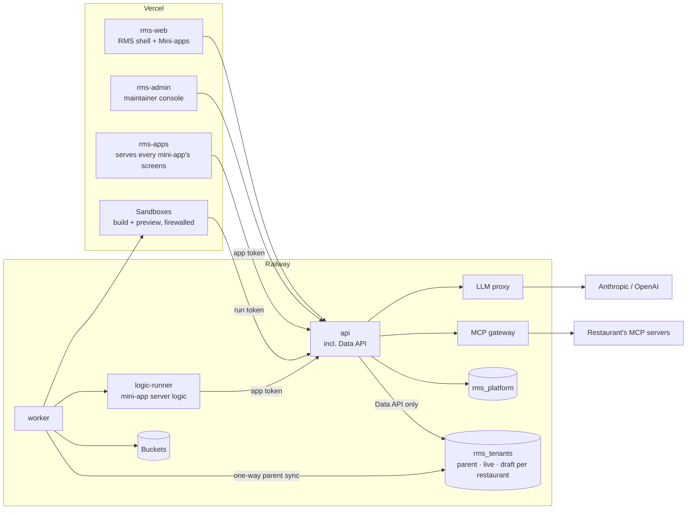

# RMS Implementation Plan (v1)

**RMS** is the product. **Mini-apps** is the area inside RMS where a restaurant builds its own apps or installs one from the marketplace. This is a personal project with no connection to TradeEngage. Never use TradeEngage accounts, teams, repos or data for it.

Every item is marked **DECIDED** (Rahul confirmed), **PROPOSED** (my recommendation) or **OPEN** (needs an answer).

Companion files: [01-data-model.md](./01-data-model.md), [02-restaurant-domain.md](./02-restaurant-domain.md), and [03-demo-build.md](./03-demo-build.md).

**Building the demo today? Work from file 03.** It is a cut of this plan and wins where the two differ.

**What changed from v0**

- Mini-apps are built only from the maintainers' design system. Restaurants customise through themes and composition.
- Parent data (what RMS holds about a restaurant) is read-only to restaurants and agents. Child data is theirs.
- One data store per restaurant with a shared model library, so mini-apps reuse tables instead of duplicating them.
- Mini-apps reach data only through the platform's Data API. They hold no database access.
- Hosting uses both platforms: screens served through Vercel, server logic in a locked runner on Railway.
- The agent remembers each restaurant and checks for an existing mini-app before building a new one.
- The marketplace has a recommendations section and lets restaurants reuse apps that other restaurants made public.

---

## 0. Read first: caveats

1. **Vercel Hobby is for non-commercial use.** Fine for the pilot build. Hosting must move to a paid plan before real restaurants use it. Hosting sits behind an interface so that is a config change.
2. **Vercel Sandbox on Hobby is small**: about 5 CPU hours a month, 45 minute sessions, 10 at once. Development only.
3. **The Data API is now the most critical code in the system.** Every mini-app read and write goes through it. It gets the most review and the most tests.
4. **Security rules will sometimes say no to a restaurant.** A mini-app cannot add outside code libraries, call arbitrary websites, or skip a failed security check. That is the price of "cannot build something insecure". Exceptions come to us as requests.
5. **Six assumptions are unproven.** Phase 0 has a short spike for each, with a fallback named.
6. **The Vercel connector is now on the personal account** (`rtspirit`, team `rtspirits-projects`). It currently shows no projects in that team, so the three RMS projects will be new. The guardrail in section 8 still applies to every command.

---

## 1. What we are building

| Term | Meaning |
|---|---|
| **RMS** | The parent product and its shell: sign-in, navigation, settings, the restaurant's parent data |
| **Mini-apps** | The area in RMS with two tabs: **Build** (make your own with the agent) and **Marketplace** (install an existing one) |
| **Mini-app** | One app a restaurant uses. Real code, built by the agent from our parts |
| **Agent** | Claude or OpenAI. Builds mini-apps, answers questions, changes settings |
| **Parent data** | What RMS holds about a restaurant. Read-only to the restaurant's mini-apps and to the agent |
| **Child data** | The restaurant's own store. Theirs to add to and change |
| **Maintainer console** | Our admin system |

The person building is a **non-technical owner or manager** who may never have used an AI agent. They describe what they want in everyday words. The agent does the rest and never shows code, table names or error text.

### Four rules that shape everything

1. **Tenants never fork the platform.** They extend it through settings, slots and mini-apps.
2. **Parent data flows one way.** Restaurants and agents can read it and build on it. They can never change or delete it.
3. **Reuse before build.** An existing mini-app before a new one. An existing table before a new one. An existing component before a new one.
4. **Secure by construction.** The safe way is the only way the parts fit together. A mini-app that breaks a security rule cannot be published.

---

## 2. Decisions

| # | Topic | Choice | Status |
|---|---|---|---|
| D1 | What the agent produces | A real codebase per mini-app, from our template, using our SDK and design system | DECIDED |
| D2 | Major changes | Tiered by risk. Tenant-scoped changes apply and notify us. Platform-touching changes wait for approval | DECIDED |
| D3 | Language | TypeScript everywhere, one monorepo | DECIDED |
| D4 | Design | impeccable skill. No UI is built before Rahul approves the look | DECIDED |
| D5 | Stack | GitHub, Vercel personal team, Railway | DECIDED |
| D6 | Naming | Product is RMS. The build and marketplace area is Mini-apps | DECIDED |
| D7 | Who builds | Non-technical owner or manager. Plain-language conversation. Code hidden | DECIDED |
| D8 | Parent data | Read-only to restaurants and agents, enforced by the database | DECIDED |
| D9 | Design system | All mini-app UI comes from the maintainers' design system. Restaurants theme and compose | DECIDED |
| D10 | Data details | Franchise roll-up is a nightly copy. Retention as in the data model. Connection calls keep a redacted argument summary | DECIDED |
| D11 | Monorepo tooling | pnpm workspaces + Turborepo | PROPOSED |
| D12 | Web apps | Next.js on Vercel: `rms-web` (restaurants), `rms-admin` (maintainers), `rms-apps` (serves every mini-app's screens) | PROPOSED |
| D13 | Backend | Node services on Railway: `api`, `worker`, `logic-runner` | PROPOSED |
| D14 | Database | Postgres on Railway, Drizzle. Two databases: `rms_platform`, `rms_tenants` | PROPOSED |
| D15 | Queue and files | pg-boss to start. Railway Buckets | PROPOSED |
| D16 | Auth | Better Auth with organizations | PROPOSED, spike S5 |
| D17 | Build agent | OpenAI Codex SDK and Claude Agent SDK inside the sandbox, behind one `AgentDriver` interface. **OpenAI first** (Rahul's call for the demo), Claude after | DECIDED order, spikes S1 S2 |
| D18 | Ask agent | Vercel AI SDK in the worker. Tools from MCP only | PROPOSED |
| D19 | Sandbox | Vercel Sandbox with its firewall set to block everything except our gateways | PROPOSED, spike S1 |
| D20 | Hosting mini-apps | **Both platforms.** Screens: one shared Vercel project, separate domain, strict browser policy. Server logic: a locked runner on Railway's private network | PROPOSED, spike S3 |
| D21 | Restaurant data | One store per restaurant. Shared model library. Mini-apps use the Data API only | PROPOSED, spike S6 |
| D22 | LLM keys | Platform keys, metered per restaurant. Keys never enter a sandbox | PROPOSED |
| D23 | Outside code libraries | A fixed allow list ships in the template. Anything else is a request to us | PROPOSED |
| D24 | Public mini-apps | Owner opts in, automated scan, maintainer approval. Code and table shapes only, never data. A listing shows the title and what the mini-app does. **No restaurant name, ever** | DECIDED |
| D25 | Parent data on day one | Profile, locations, staff, menu, plus licences and equipment. Fake data for the demo | DECIDED |
| D26 | Point-of-sale data | Child data. The restaurant connected it, so it is theirs to shape | DECIDED |
| D27 | Demo stack | Vercel plus Supabase (Postgres, sign-in, files). Railway returns after the demo. See file 03 | DECIDED for the demo |

**Why D20 beats one Vercel project per mini-app**: no per-project limits, nothing idle to pay for, the browser itself blocks a mini-app from sending data anywhere but RMS, and server logic runs where we control the network.

---

## 3. Use cases and what they require

Mini-apps restaurants will want: inventory and ordering, recipe costing, vendor price tracking, invoice scanning, staff scheduling, time and attendance, payroll prep and tip pooling, daily cash close, accounts and P&L, delivery payout reconciliation, reservations and waitlist, catering orders, loyalty and gift cards, food safety logs, checklists, waste log, maintenance tickets, licence expiry tracking, training, customer feedback, sales forecasting, and for franchises: roll-up dashboards and royalty reporting.

| Need | Why | Where it lands |
|---|---|---|
| Works on phones and kitchen tablets | Most entry happens on the floor | Design system is touch-first |
| Roles scoped to locations | A shift lead sees one store | Enforced by the Data API, not by mini-app code |
| Money, units and business-day handling | A shift ending at 2am is still Friday. A case is not a kilo | Built into the model library |
| The same vendors, staff and items everywhere | Payroll and scheduling must agree | Shared models in one store |
| Scheduled jobs and webhooks | Nightly counts, point-of-sale events | SDK `jobs`, platform scheduler |
| Reading documents | Invoices, receipts, permits | SDK `files`, SDK `ai` |
| Notifications | Low stock, shift changes | SDK `notify` |
| Integrations | Point of sale, payroll, accounting, delivery | MCP connections |
| Exports and audit trail | Accountants, inspectors | Data API audit, CSV and PDF export |

Not in the first version: offline mode, printing, realtime sync, native apps.

---

## 4. Architecture

### 4.1 Who owns what

| Layer | What | Who changes it |
|---|---|---|
| Platform core | Shell, auth, SDK, Data API, gateways, **design system**, **model library**, agent runtime | Maintainers only |
| Parent data | What RMS holds about each restaurant | RMS services only |
| Settings | Theme, navigation, roles, agent instructions | The restaurant, freely |
| Mini-apps and child data | Generated code, and the restaurant's own tables | The restaurant, inside the rules |
| Platform requests | Anything that needs the core to change | Restaurant asks, we decide |

### 4.2 System diagram



Only `api` and two platform jobs ever connect to `rms_tenants`. Mini-app code, in any environment, never does.

### 4.3 Repo layout

```
apps/
  web/            RMS shell and the Mini-apps area         -> Vercel
  admin/          maintainer console                       -> Vercel
  apps-host/      serves mini-app screens on the apps domain -> Vercel
  api/            REST, streaming, Data API, LLM proxy, MCP gateway, RMS MCP server -> Railway
  worker/         agent runs, builds, publishes, parent sync, notifications -> Railway
  logic-runner/   runs mini-app server logic in isolation   -> Railway
packages/
  contracts/      zod schemas and types shared by everything
  db/             Drizzle schema + migrations for rms_platform and the parent schemas
  models/         the model library, the definition format, the compiler to SQL and typed clients
  data/           Data API core: authorisation, query builder, masking, audit
  auth/           Better Auth config, permission checks, token minting
  agent/          AgentDriver, drivers, prompts, Ask agent, memory
  runner/         the program that drives the build agent inside a sandbox
  sandbox/        SandboxProvider + Vercel Sandbox implementation
  publish/        build, scan, store and serve a mini-app version
  governance/     change-set detectors, tier rules, policy table
  mcp/            gateway client, connections, catalog
  sdk/            @rms/sdk, used by every mini-app
  ui/             @rms/ui: tokens, components, patterns, the catalog the agent reads
  generators/     commands that scaffold pages and logic from a model and a pattern
  app-template/   the starter every mini-app begins from
  config/         shared tsconfig, eslint (including the security rules), prettier
docs/plan/, docs/adr/, PRODUCT.md, DESIGN.md, CLAUDE.md, .claude/
```

### 4.4 Design system

`@rms/ui` is the same library RMS itself is built with. Maintainers own it and improve it over time.

**Layers**

| Layer | Examples | Who can change |
|---|---|---|
| Tokens | Colour, type, spacing, radius, density | Maintainers set defaults. A restaurant overrides a safe subset (brand colour, logo, density) |
| Components | Button, field, table, sheet, date picker, money input, quantity input | Maintainers |
| Patterns | List with detail, form, dashboard, checklist, schedule grid, report table, approval queue | Maintainers |
| Compositions | A mini-app's own screens and its own components, assembled from the layers above | The agent, per mini-app |

**What a restaurant can customise**: its theme (applies to all its mini-apps at once), the layout and content of every screen, and custom components made by combining ours.

**What is blocked**: other UI libraries, hand-written stylesheets, inline styles outside the tokens, direct page manipulation. The build fails if any appear.

**How maintainer updates reach mini-apps**

- *Theme and token changes* are delivered at load time. Every mini-app picks them up at once, with no rebuild.
- *Component and pattern releases* are versioned. A fleet job rebuilds each published mini-app against the new version in a sandbox, runs its checks and compares screenshots. Clean results publish automatically. Differences are flagged to the owner with the agent ready to fix them.
- Breaking releases are rare and come with an automated rewrite.

**Why builds are fast**

1. A sandbox snapshot with the template and all allowed libraries already installed. Nothing downloads at build time.
2. **Generators first.** For "a list of vendors with a form", the agent runs one command that writes the page from the pattern and the model in seconds. Then it edits what is specific.
3. The agent reads a compact catalog of components, patterns and models through a tool. It does not explore the codebase to find them.
4. Reused tables need no data work at all.
5. Starter recipes for the most common requests, and marketplace mini-apps as starting points.

Target to validate in Phase 4: a first working preview within two minutes of the owner confirming the plan.

### 4.5 How a mini-app gets built

1. **Intake.** The owner says what they want in their own words.
2. **Context.** The agent loads what it knows about this restaurant: parent data, memory from earlier conversations, existing mini-apps and tables, connected systems.
3. **Already have it?** The platform compares the request with the restaurant's existing mini-apps. On a match the agent says so and offers three choices: open it, add to it, or build a separate one anyway.
4. **Does one exist to reuse?** The platform checks the marketplace. On a good match the agent shows it as an option before building from scratch.
5. **Plan in plain words.** At most three short questions, then a summary: the screens, what information it will keep, what it will read from RMS, what it will connect to. The owner confirms.
6. **Data.** Reuse first: existing table, then library model, then a new custom model (data model doc, section 5). If the owner gave little detail, the agent fills gaps from parent data and shows what it assumed.
7. **Code.** In the sandbox: generators, then edits. Events stream to the browser and can resume after a dropped connection.
8. **Checks.** Typecheck, lint with the security rules, build, tests, dependency and secret scan. Failures go back to the agent. The owner only ever sees "still working" or a plain explanation.
9. **Version and change set.** Source is committed and stored. Governance classifies the change.
10. **Preview.** The owner tries it on sample data in the draft store, on their phone if they like.

### 4.6 How a mini-app runs after publish

- **Screens** are built files, stored in the bucket and served by `apps-host` on a separate domain. The browser policy for that domain only allows calls to RMS.
- **Inside RMS**, a mini-app shows in a frame. The shell hands it a short-lived token. No cookies live on the apps domain. Opened on its own (a phone home-screen icon), it signs in through RMS.
- **Data** goes through the SDK to the Data API. The token carries the restaurant, the user, the mini-app and the user's locations. Nothing in a request can name another restaurant.
- **Server logic** (multi-step actions, jobs, webhooks) runs in `logic-runner`: no file system, no secrets, network limited to our gateways, time and memory capped.
- **Jobs and webhooks** are declared in the manifest. The platform scheduler triggers them.
- **Rollback**: the previous build stays in the bucket. Switching back is one row.

Manifest, `rms.config.ts`:

```ts
export default defineApp({
  name: "Vendors & Bills",
  slots: [{ type: "nav" }, { type: "dashboard-widget", component: "BillsDue" }],
  models: [
    { use: "vendor", access: "write" },
    { use: "vendor_bill", access: "write" },
    { use: "parent.locations", access: "read" }
  ],
  connections: [{ id: "accounting", tools: ["list_bills"], access: "read" }],
  jobs: [{ name: "due-reminders", cron: "0 8 * * *" }],
  tools: ["bills_due_this_week"]   // offered to the Ask agent and the restaurant's own MCP endpoint
});
```

Governance reads manifest diffs. "This mini-app now wants to write staff pay rates" is caught by a rule.

### 4.7 Agents and providers

| Mode | What it does | Where it runs | Tools |
|---|---|---|---|
| **Build** | Writes and changes mini-app code | The mini-app's sandbox | Files, shell, generators, catalog, model tools, allowed connection tools |
| **Ask** | Answers questions about the restaurant | `worker` | Read-only query tool, mini-app tools, allowed connection tools |
| **Customize** | Changes RMS settings | `worker` | One tool: propose a settings patch |

- `AgentDriver` hides the provider. `ClaudeDriver` wraps the Claude Agent SDK, `OpenAIDriver` wraps the Codex SDK. Provider and model are chosen per restaurant and recorded per session.
- All model traffic goes through our LLM proxy, which adds the key, counts tokens and enforces the budget.
- **Memory.** After each session the agent saves a short summary and any lasting facts ("counts stock on Sundays", "the bar is a separate revenue centre") to the restaurant's memory, with where each came from. The next session starts with them. The owner can read and delete them.
- **Conversation rules for non-technical owners**: everyday words only, at most three questions before showing something, always show what was assumed, every confirmation says what will happen in one sentence, undo is always offered.

### 4.8 MCP connections

All MCP traffic goes through our gateway. Agents and mini-apps hold a scoped RMS token, never the restaurant's credentials.

Ways to connect, in build order: custom URL (OAuth, bearer token, custom headers, none), catalog entries, each restaurant's RMS exposed as its own MCP server, and later an API wrapper for vendors with no MCP server and an on-site bridge for local systems.

Permissions are per connection, per consumer, per tool, read or write. Destructive tools ask the user first. A changed tool list needs approval again. Tool output is treated as data, never as instructions. Each call keeps a redacted argument summary, and what the agent learns about using a connection is saved as notes for next time.

### 4.9 Governance

Every change becomes a **change set**: what changed, where, by whom, with the diff.

| Tier | Examples | What happens |
|---|---|---|
| T0 Cosmetic | Theme, labels, layout | Applies. Logged |
| T1 Minor | Screen and logic changes. A new table or optional field | Applies. Counted in the feed |
| T2 Major, tenant-scoped | A change that alters or removes existing data. A new connection or write access. A new job or webhook. Role changes. First publish. Anything touching fields tagged payroll or financial | Owner confirms in plain words, it applies, **we are notified** |
| T3 Touches the platform | A new outside library. A new allowed website. Sharing data across restaurants. **Publishing a mini-app publicly.** A quota raise. Anything a security check blocked | **Held** until a maintainer approves |

**How a tier is decided**: rules first (files touched, manifest diff, model diff, dependency diff), then a model writes a plain summary and may raise the tier but never lower it, then a policy table maps the tier to an action. All of it is stored on the change set.

**How we are told**: an outbox row in the same transaction, delivered to the console feed (always), a daily digest, Slack for T3 and urgent T2, and a GitHub issue when we accept a platform request.

**Platform requests**: when a restaurant needs something only we can do, the agent writes it up. We accept, decline or answer. The owner sees the status.

**Maintainer console**: change feed, review queue, platform requests, restaurants (with time-boxed logged impersonation), mini-apps, agent runs and cost, sandboxes, connection catalog, design system releases and which mini-apps are behind, model demand (custom models many restaurants have made), marketplace review, feature flags, kill switches.

### 4.10 Marketplace and recommendations

**Three sources of mini-apps**: ours, a franchise parent's private catalog for its own locations, and mini-apps other restaurants chose to make public.

**Making one public**

1. The owner chooses to share. Default is always private.
2. The platform scrubs: sample and real data removed, connections and secrets removed, memory removed, the source scanned for anything that looks like real names, numbers or addresses.
3. The same security checks as publishing, plus a maintainer review (T3).
4. It is listed with a title, a description of what it does, what tables it needs and what connections it can use. The restaurant that made it is never named.

What travels: code and table shapes. What never travels: any data, any connection, anything the agent remembered.

**Installing**: the source is forked into the installer's restaurant. Required tables are matched to ones they already have, or created. Updates from the original arrive as an offer, merged with the installer's own changes.

**Recommendations**

- A **Recommended for you** row in the Marketplace tab, refreshed nightly. Scored from the restaurant's profile (type, size, service style), the tables and connections it already has, and what similar restaurants installed. Each one says why it was suggested.
- **At build time** (step 4 of 4.5): before building from scratch, the agent shows close matches.
- Only listings that are public and approved are ever candidates. A private mini-app has no listing, so nothing can surface it.

### 4.11 Security: secure by construction

| Risk | How the design removes it |
|---|---|
| One restaurant seeing another's data | The Data API takes the restaurant from the signed token, never from the request. Each restaurant has its own schemas and its own database roles. The Ask query login exists for one restaurant only and has no rights anywhere else |
| Changing parent data | Restaurant roles have read permission only on the parent schema. No write route exists |
| A mini-app leaking data | Screens can only call RMS (browser policy). Server logic can only reach our gateways. Sandboxes block all other network |
| A user seeing more than their role allows | Location and role rules are applied by the Data API and the database, so mini-app code cannot forget them |
| Unsafe code | No raw SQL, no database credentials, no secrets in code. Lint rules ban unsafe page injection, dynamic code, direct network calls. Auth, layout shell and data client in the template are locked files |
| Unsafe libraries | Fixed allow list. Nothing installs at build time |
| A hostile connection or document steering the agent | Tool output is data. Destructive actions need the user. Changed tools need approval again. The agent cannot widen its own permissions |
| A bad publish | Publish runs every check again. A failure blocks it. The owner cannot override. Only a maintainer can grant an exception |
| Runaway cost | Budgets on tokens, sandbox time, runs, queries |
| Maintainer misuse | Separate users, separate app, every action logged, impersonation time-boxed |

A **tenant-isolation and attack test suite** runs on every build from Phase 1 and blocks merges. A security reviewer agent checks every pull request that touches the Data API, tokens, gateways, the runner or the query tool.

### 4.12 Scalability path

| Part | Start | When it grows |
|---|---|---|
| `api`, `worker`, `logic-runner` | One instance each, stateless | Add instances. Split Data API, LLM proxy and MCP gateway into their own services |
| Platform database | One Postgres | Partition high-volume tables. Read replica. Move transcripts to the bucket |
| Restaurant stores | Three schemas per restaurant in one database | Cells: a placement table maps each restaurant to a server. Large ones get their own |
| Mini-app screens | One shared host, files from the bucket, cached at the edge | Nothing to change. It is static files |
| Sandboxes | Saved when idle | Per-restaurant limits, a run queue, a second provider through the interface |
| Regions | US | Region field on the org from day one. Cells per region |

---

## 5. Design track (impeccable)

Runs in parallel with engineering and stays one surface ahead.

1. `/impeccable init` writes `PRODUCT.md`.
2. **Look approval.** Two or three visual directions shown as real screens: Mini-apps home, the build conversation with a live preview, a finished mini-app on a phone, the Marketplace with recommendations, the maintainer change feed. Rahul picks. **Nothing is built before this.**
3. `DESIGN.md` and `@rms/ui` tokens are written from the approved direction.
4. Per surface: `/impeccable shape`, build, `/impeccable critique` and `/impeccable audit`, `/impeccable polish`. Rahul sees each before it merges.
5. Patterns in `@rms/ui` get the same treatment, because every mini-app inherits them.

impeccable's file-edit hooks were not installed. Turn them on with `/impeccable hooks on` if wanted.

---

## 6. Phases

Each phase ends with a working demo and Rahul's sign-off. These are the full phases. Today's demo order is in file 03.

### Phase 0: Foundation and proof

Sequential: monorepo scaffold, CI, `CLAUDE.md`, agent definitions, contracts skeleton, Railway project (both databases, a bucket), Vercel projects with the guardrail.

Parallel spikes, two days each at most, throwaway code, one-page finding each:

| Spike | Question | If it fails |
|---|---|---|
| S1 | Can the OpenAI Codex SDK run in a Vercel Sandbox with the firewall allowing only our gateways, edit the template, and stream events out? | Sandboxes as containers on Railway |
| S2 | Same for the Claude Agent SDK | Claude waits, OpenAI ships first |
| S3 | Can `logic-runner` run untrusted server logic on Railway with no network except our gateways, and start fast enough for a button press? | Run server logic in Vercel Sandbox with the same firewall |
| S4 | Do both SDKs work through our LLM proxy with a run token? | The sandbox firewall injects keys itself, and we meter from provider usage reports |
| S5 | Can Better Auth run organizations, and can the shell hand a framed mini-app on another domain a short-lived token? | Clerk or WorkOS |
| S6 | How many restaurants (three schemas, about fifty tables each) can one Postgres hold before the Data API and model changes slow down? | Fewer restaurants per cell, or shared tables for the most common models |

Parallel design: steps 1 and 2 of section 5.

Exit: each spike has a go or a fallback. Look approved. Data model signed off.

### Phase 1: Tenancy, shell, parent data

- Sign-up, organizations, locations, roles, invitations. Onboarding questions that fill the restaurant profile.
- Parent data tables, and the one-way sync into each restaurant's parent schema.
- `@rms/ui` v0: tokens and core components. RMS shell with an empty Mini-apps area.
- Audit log, change sets, outbox. Maintainer console skeleton.
- Isolation test suite.

Exit: two restaurants exist, neither can see the other in any test, and a write to parent data through any restaurant path is refused by the database.

### Phase 2: Agent core, Ask, memory

- Sessions, runs, events, streaming with resume. LLM proxy with budgets. First driver (OpenAI).
- The read-only query tool with all seven protections from the data model doc, and its attack suite.
- Restaurant memory: save, retrieve, view, delete.

Exit: an owner asks about their locations and staff and gets a correct answer. The attack suite passes. A fact from one session is used in the next.

### Phase 3: Data layer

Can run alongside Phase 2.

- Model definition format and compiler. Library packs: Foundation, Sales, Finance, then Inventory and Labour.
- Restaurant store provisioning: live and draft schemas, roles.
- Data API: authorisation, query builder, masking, audit, batch writes, named queries, parent references.
- Reuse-first model search. Model change pipeline with impact checks.

Exit: two test mini-app manifests share the `vendor` model. A field removal that one of them depends on is blocked. A staff-role user cannot read a payroll-tagged field through any request.

### Phase 4: Build loop

- `app-template`, `@rms/sdk`, `@rms/ui` patterns, generators, the catalog tool.
- Sandbox, runner, the ten steps of 4.5 including the duplicate check.
- Security lint rules, dependency allow list, locked files.
- Versions, checks, change sets, preview on the draft store.
- Second driver (Claude) once the first works end to end.

Exit: an owner types "I want to keep track of who I buy from and what I owe them" and has a working preview. Asking the same again gets "you already have this".

### Phase 5: Publish and run

- Build and store bundles. `apps-host` on the apps domain with the browser policy. Token hand-off.
- `logic-runner`, jobs, webhooks. Rollback. Pause, delete, export source.
- Fleet rebuild for design system releases.

Exit: the mini-app is published, used on a phone, changed, republished, rolled back, and survives a design system update.

### Phase 6: MCP

- Gateway, custom URL connections, tool permissions, confirm-before-write, argument summaries, connection notes.
- Catalog and its console screen. Per-restaurant MCP endpoint. SDK `mcp` and `ai`.

Exit: connect an outside MCP server, Ask answers from it, a mini-app calls it, and Claude desktop connects to the restaurant's own endpoint.

### Phase 7: Governance and customization

Console screens can be built alongside Phases 5 and 6.

- Settings, themes, Customize mode, shell slots.
- Detectors, tier rules, summaries, policy table. Notifier. Review queue. Platform requests. Kill switches.

Exit: a scripted run produces one change of each tier and each does what the table says.

### Phase 8: Accounts mini-app (the test)

- On a demo restaurant, build the accounts mini-app **only through Mini-apps**: daily sales in, balanced ledger, weekly and period P&L, prime cost. Sales entered by hand, by upload, and from one point-of-sale connection.
- It becomes the first marketplace listing.

Exit: a correct P&L for sample data, and a written list of what could not be done unaided.

### Phase 9: Marketplace and recommendations

- Listings, the public sharing flow with scrub and review, install as a fork with table matching, updates as a merge.
- Recommended for you. Build-time suggestions. Franchise private catalog.

Exit: restaurant A shares a mini-app. After approval, restaurant B sees it recommended with a reason, installs it onto its existing tables, and gets none of A's data.

### Running alongside all phases

Logs with restaurant, mini-app and run ids. Error tracking. Load tests. A restore drill. A security review at the end of Phases 1 to 6.

---

## 7. How Claude Code should run this

### Agents

Defined in `.claude/agents/`. The lead is the main session.

| Agent | Model | Can edit | Job |
|---|---|---|---|
| lead | Most capable | Yes | Owns `contracts`, `db`, the model definition format and `ui` tokens. Splits phases into tasks. Integrates |
| architect-reviewer | Most capable | No | Reviews contract, data model and Data API changes before work fans out |
| implementer | Opus 5.5 for well-specified tasks. Most capable for Data API, runner, gateways, tokens, governance | Only the files in its brief | Builds one task |
| designer | Most capable | UI files | Uses impeccable and its helper agents |
| domain-modeller | Most capable | `packages/models` | Writes library models from file 02, with the rules in its section 4 as tests |
| code-reviewer | Most capable | No | Fresh context. Never reviews its own work |
| security-reviewer | Most capable | No | Isolation, tokens, the query tool, sandbox and runner limits. Writes attack tests |
| qa | Opus 5.5 | Tests only | End-to-end, isolation suite, regression |

### Rules

1. **Contracts first.** The lead writes each phase's types and tables and gets them reviewed. Then work fans out.
2. **One worktree per task.** No two agents edit the same files.
3. **Every task has a brief**: goal, files owned, contracts to follow, checks that prove it is done, what is out of scope.
4. **Every task ends by running its checks**, including the isolation suite if it touches data.
5. **Review is separate from authorship.** Security review is required for anything in 4.11.
6. **UI needs an approved design**, and Rahul sees it before it merges.
7. **Small pull requests.** A decision that changes this plan gets a file in `docs/adr/` and an edit here in the same pull request.
8. **Human checkpoints**: look approval, data model sign-off, spike findings, end of each phase.

### What runs in parallel

```
Phase 0   scaffold ──► spikes S1..S6                      design: init ► directions ► approval
Phase 1   contracts ──► auth | tenancy | parent data+sync | ui v0 + shell | console skeleton | audit
Phase 2   contracts ──► runs+streaming | LLM proxy | first driver | query tool + attack suite | memory
Phase 3   contracts ──► model compiler | library packs | store provisioning | Data API | change pipeline
          (Phases 2 and 3 overlap once Phase 1 is merged)
Phase 4   contracts ──► template+SDK | patterns+generators | sandbox+runner | intake+duplicate check | preview UI
Phase 5   contracts ──► bundles+apps-host | logic-runner | jobs+webhooks | fleet rebuild
Phase 6   contracts ──► gateway | connections UI | catalog | outbound MCP
Phase 7   contracts ──► settings+slots | detectors+policy | notifier | console screens
Phase 9   contracts ──► sharing flow | install+matching | recommendations
```

---

## 8. Deploy guardrails

- `scripts/preflight-vercel.sh` runs before any Vercel command. It stops unless the team matches the personal team id stored in `.rms/vercel-team` (`team_RM4toarAtl8vljERLdxRvfeh`, slug `rtspirits-projects`), and stops if the name contains "tradeengage" or "te-team".
- Same for Railway with a stored project id.
- No agent creates, deletes or renames a Vercel or Railway project without Rahul confirming in that session.
- Secrets live in Vercel and Railway settings, never in the repo.

---

## 9. Open questions

| # | Question | My recommendation |
|---|---|---|
| O4 | Two domains are needed: one for RMS, one for mini-apps | Not needed for the demo. Pick before real users |
| O5 | Franchise depth: parent and child only, or area developers in between? | Model a tree, build screens for two levels |

Assumed unless you object: platform LLM keys first, US only at the start, billing after Phase 8 with usage metered from Phase 2, private repo with GitHub Actions.

---

## 10. Sources checked

- Vercel Sandbox pricing and limits: https://vercel.com/docs/sandbox/pricing
- Vercel Sandbox firewall: https://vercel.com/docs/sandbox/concepts/firewall
- Vercel Hobby and fair use: https://vercel.com/docs/plans/hobby , https://vercel.com/docs/limits/fair-use-guidelines
- Claude Agent SDK hosting: https://code.claude.com/docs/en/agent-sdk/hosting
- OpenAI Codex SDK: https://developers.openai.com/codex/sdk
- Better Auth OAuth provider: https://better-auth.com/docs/plugins/oauth-provider
- Railway buckets: https://docs.railway.com/storage-buckets
- impeccable: https://github.com/pbakaus/impeccable
- Restaurant domain sources are listed in file 02.

Limits and prices change. Re-check at the start of Phase 0.
