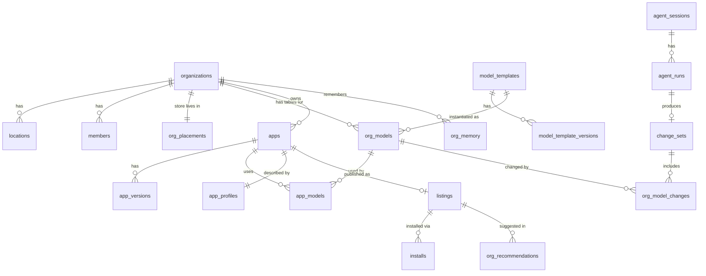

# RMS Data Model and Scalability (v1)

Companion to [00-implementation-plan.md](./00-implementation-plan.md). The model library itself is in [02-restaurant-domain.md](./02-restaurant-domain.md). Status: **PROPOSED**, needs Rahul's sign-off before Phase 1.

**What changed from v0**

- One data store per restaurant, shared by all its mini-apps. No more schema per app.
- A model library: mini-apps reuse existing tables before creating new ones.
- Parent data is a separate read-only area. Nothing a restaurant or an agent does can change it.
- Mini-apps no longer connect to the database. All data goes through the platform's Data API.
- New tables for restaurant memory, duplicate detection, and marketplace recommendations.

**Demo note**: today's demo runs on one Supabase database with a `platform` schema beside the restaurant schemas, instead of two databases. File 03 lists that shortcut and how to undo it.

---

## 0. Read first: the risky parts

1. **The Data API becomes the most important piece of code we own.** Every mini-app read and write passes through it. It must be fast, and it must be correct about who can see what.
2. **Shared models mean one mini-app's change can affect another.** The platform tracks which mini-apps use which fields and blocks or warns before anything breaks.
3. **Two databases means no foreign keys between them.** Platform rows point at tenant tables by id and name. A reconcile job checks they agree.
4. **Agent transcripts will contain personal and financial data.** Redaction rules must be in place before a real restaurant is onboarded.

---

## 1. Four kinds of data

| Kind | What | Who can change it | Where |
|---|---|---|---|
| **Platform** | Orgs, users, mini-apps, agent runs, connections, governance | RMS services | `rms_platform` |
| **Parent** | What RMS itself holds about a restaurant: profile, locations, staff, menu, and whatever else RMS collects | RMS services only. **Never** a restaurant's mini-app or agent | Source of truth in `rms_platform`, read-only copy in the restaurant's parent schema |
| **Child, standard** | Tables made from our model library (vendors, bills, sales days, ...) | The restaurant, through its mini-apps | The restaurant's store |
| **Child, custom** | Tables the agent designed for this restaurant because nothing in the library fit | The restaurant, through its mini-apps | The restaurant's store |

### The one-way rule

Parent data flows **down** only.

- A sync job copies parent data into each restaurant's parent schema. Restaurant roles have read permission there and nothing else. The database itself refuses any write.
- The Data API has no write routes for parent models. The agent's tools for parent data are read-only.
- Child rows can **point at** a parent row (a recipe points at a parent menu item). They can **extend** it (a costing table keyed by the parent menu item id). They can **copy from** it (seed a staff schedule from the parent staff list). They can never change it.
- If a parent row is later removed, child rows that point at it keep working and show the last known label.

### How the agent uses parent data

When a restaurant asks for a mini-app with little detail, the agent reads the parent data first: what kind of restaurant, how many locations, the menu, the staff, what is connected. It uses that to choose models, add fields that fit, and pre-fill the child store with a sensible starting set, which the owner confirms in plain language before it is saved.

---

## 2. Conventions

- **Ids**: `uuid` version 7, generated in application code so they sort by time. Public ids carry a prefix (`org_`, `app_`, `run_`).
- **Tenant column**: every tenant-owned table in `rms_platform` has `org_id uuid not null`. Every index and unique constraint on those tables starts with `org_id`.
- **Row-level security**: on for every tenant-owned platform table, and on every location-scoped table in a restaurant's store.
- **Money**: `bigint` minor units plus `currency char(3)`. LLM cost is stored in micros (millionths of a dollar).
- **Quantities**: a number plus a unit id. Never a bare number.
- **Time**: `timestamptz` in UTC. **Business date**: a `date` from the location's timezone and day cutoff (default 04:00).
- **Status fields**: `text` with a check constraint.
- **Deleting**: user-facing rows are soft deleted. Ledgers, stock movements, audit and events are append-only.
- **Sensitivity tags**: each field can be tagged personal, payroll or financial. Tags drive masking in sample data, logs, Ask answers shown to lower roles, and anything published to the marketplace.
- **JSON columns**: only where the shape truly varies. Relationships are real columns.

---

## 3. `rms_platform` tables

Columns listed are the important ones.

### 3.1 Identity and tenancy

| Table | Key columns | Notes |
|---|---|---|
| `users`, `sessions`, `accounts`, `verifications` | | Auth library tables |
| `organizations` | slug, name, kind, parent_org_id, region, plan, status, default_provider, default_model | `kind`: independent, franchisor, franchisee, group |
| `org_closure` | ancestor_id, descendant_id, depth | Fast "everything under this franchisor" |
| `brands` | org_id, name | |
| `locations` | org_id, brand_id, name, address, timezone, currency, day_cutoff, status | |
| `members` | org_id, user_id, role_id, status | Unique on (org_id, user_id) |
| `member_locations` | member_id, location_id | No rows means all locations |
| `roles` | org_id (null for built-in), key, name, permissions[] | Built-in: owner, admin, manager, staff |
| `invitations`, `api_tokens` | | |
| `data_sharing_grants` | from_org_id, to_org_id, scope, status | Franchise roll-up. **Decided: a nightly copy**, not live access |

### 3.2 Parent data

| Table | Key columns | Notes |
|---|---|---|
| `restaurant_profiles` | org_id, concept, cuisine, service_style, seats, price_band, hours, systems_used | Collected at onboarding. Drives agent context and marketplace recommendations |
| `parent_staff`, `parent_jobs`, `parent_menu_categories`, `parent_menu_items`, `parent_menu_modifiers`, `parent_tax_rates`, `parent_licences`, `parent_equipment` | org_id, ... | **Decided** for day one. Fake data for the demo |
| `parent_models` | key, version, definition | Describes each parent model so the agent and the Data API know its shape |
| `parent_sync_state` | org_id, model_key, cursor, synced_at | Progress of the one-way copy into each restaurant's parent schema |

### 3.3 Model library and per-restaurant models

| Table | Key columns | Notes |
|---|---|---|
| `model_templates` | key, pack, name, description, status | The library we maintain (file 02) |
| `model_template_versions` | template_id, version, definition, changelog, breaking | A definition lists fields, types, relations, rules, sensitivity tags, default access |
| `org_models` | org_id, key, kind, template_id, template_version, definition, table_name, status, created_by_run_id | `kind`: standard, custom. `definition` is the restaurant's effective version, including fields it added |
| `org_model_changes` | org_id, model_id, change_set_id, diff, compiled_sql, destructive, applied_draft_at, applied_live_at, backup_key | The agent proposes a structured diff. The platform compiles the SQL. The agent never writes table changes itself |
| `app_models` | app_id, org_id, org_model_id, access, fields_used[] | Which mini-app uses which model and which fields. Powers reuse, impact checks and recommendations |
| `model_demand` | signature, org_count, example_definition | Roll-up of similar custom models across restaurants. Tells us what to add to the library. Holds shapes only, never data |

### 3.4 Mini-apps

| Table | Key columns | Notes |
|---|---|---|
| `apps` | org_id, slug, name, kind, status, current_version_id, published_version_id, listing_id | `kind`: custom, installed, system |
| `app_versions` | app_id, org_id, number, git_sha, bundle_key, manifest, parent_version_id, run_id, checks, ui_version, status, summary | `ui_version` is the design system version it was built with |
| `app_profiles` | app_id, org_id, purpose, capabilities, embedding | A plain description of what the mini-app does, refreshed on every version. Used to catch "you already built this" |
| `deployments` | app_id, org_id, version_id, env, screens_key, logic_key, url, status | Built screens and logic bundles live in the bucket |
| `sandboxes` | app_id, org_id, provider, external_id, snapshot_ref, status, last_active_at, cpu_seconds | |
| `app_grants` | org_id, app_id, resource, access, status, approved_by | Connection tools and anything beyond the models in the manifest |
| `app_slots` | app_id, org_id, slot_type, config, position | Where the mini-app shows up in RMS |
| `app_jobs`, `app_job_runs`, `app_webhooks` | | Runs partitioned by month |

### 3.5 Agent and memory

| Table | Key columns | Notes |
|---|---|---|
| `agent_sessions` | org_id, user_id, app_id, mode, provider, model, title, status | `mode`: build, ask, customize |
| `agent_runs` | session_id, org_id, status, sandbox_id, input_tokens, output_tokens, cost_micros, change_set_id | |
| `agent_events` | run_id, session_id, org_id, seq, type, payload, payload_key | Unique on (run_id, seq). Partitioned by month. The largest table |
| `run_tokens` | org_id, run_id or app_id, kind, token_hash, scopes, expires_at | Short-lived tokens for the gateways and the Data API |
| `org_memory` | org_id, kind, text, source_session_id, embedding, superseded_by, created_at | What the agent has learned about this restaurant: facts, preferences, decisions, session summaries. Each entry records where it came from. Owners can view and delete entries |
| `connection_notes` | org_id, connection_id, text, embedding | What the agent learned about using a connection (which tool gives sales, which id means which store) |

### 3.6 Usage and budgets

| Table | Key columns |
|---|---|
| `usage_events` | org_id, kind, quantity, unit, cost_micros, provider, model, run_id, app_id, at |
| `usage_daily` | org_id, day, kind, app_id, quantity, cost_micros |
| `budgets` | org_id, period, limit_micros, hard_stop, alert_at[] |
| `llm_credentials` | org_id, provider, mode, secret_id, status |

### 3.7 Connections and secrets

| Table | Key columns | Notes |
|---|---|---|
| `secrets` | org_id, purpose, ciphertext, key_version | Never returned by the API |
| `mcp_catalog` | key, name, vendor, category, url, auth, status, verified_at | |
| `mcp_connections` | org_id, name, catalog_id, transport, url, auth_type, secret_id, status, tools, tools_hash, checked_at | A changed tool list needs approval again |
| `mcp_tool_grants` | org_id, connection_id, consumer_type, consumer_id, tool_name, access, confirm | |
| `mcp_calls` | org_id, connection_id, consumer, tool_name, args_summary, status, duration_ms, run_id, at | **Decided**: keep a redacted summary of arguments (which parameters, date ranges, counts, with personal and financial values removed) so the agent has context later. Full arguments only as a short-lived opt-in |

### 3.8 Customization and governance

| Table | Key columns | Notes |
|---|---|---|
| `org_settings`, `org_settings_versions` | org_id, version, settings | Includes the restaurant's theme tokens |
| `change_sets` | org_id, app_id, origin, run_id, actor_user_id, scopes[], env, diff_key, stats, signals, tier, summary, decision, decided_by_staff_id, decided_at, applied_at | `signals` records which rules fired |
| `change_reviews` | change_set_id, staff_id, decision, note | |
| `platform_requests` | org_id, title, body, drafted_by_run_id, status, github_issue_url | |

### 3.9 Marketplace

| Table | Key columns | Notes |
|---|---|---|
| `listings` | source_app_id, publisher_org_id, visibility, status, title, summary, category, required_models[], required_connections[], embedding, install_count | `visibility`: public, franchise. `status`: draft, in_review, listed, delisted. Only `listed` + `public` rows are ever shown to other restaurants. `publisher_org_id` is for our records only. **No restaurant name is ever shown or returned** |
| `listing_versions` | listing_id, number, bundle_key, manifest, model_definitions, scan_report, review_status | Source and model shapes only. **Never data, connections, secrets or memory** |
| `installs` | listing_id, listing_version_id, org_id, app_id, model_mapping | `model_mapping` records which of the installer's existing models each required model was matched to |
| `org_recommendations` | org_id, listing_id, score, reasons, computed_at | Refreshed nightly. `reasons` is shown to the owner ("uses your vendor list", "popular with pizza places your size") |

Private mini-apps have no listing row, so there is nothing for a search or a recommendation to find.

### 3.10 Operations

| Table | Key columns | Notes |
|---|---|---|
| `audit_log` | org_id, actor_type, actor_id, action, target_type, target_id, meta, at | Append-only, partitioned |
| `outbox` | topic, org_id, payload, status, attempts | Same transaction as the change it announces |
| `notifications` | audience, org_id, change_set_id, kind, title, body, severity, read_at | |
| `staff_users`, `staff_subscriptions`, `impersonations` | | Maintainers are separate from `users` |
| `feature_flags`, `org_flags` | | |
| `ui_releases` | version, channel, notes, released_at | Design system versions, so we know which mini-apps are behind |
| `cells`, `org_placements` | | Where each restaurant's store lives (section 9) |

### 3.11 Main relationships



---

## 4. The restaurant's store (`rms_tenants` database)

### 4.1 Three schemas per restaurant

Each org has a prefix, `o_` plus 12 hex characters.

| Schema | Holds | Who writes |
|---|---|---|
| `<prefix>_parent` | Read-only copy of parent data | The sync job only |
| `<prefix>` | Live child data: every standard and custom model the restaurant uses | Published mini-apps, through the Data API |
| `<prefix>_draft` | Same tables as live, filled with masked sample data | Mini-apps being built and previewed |

Three schemas per restaurant, however many mini-apps it has. Table count grows with the number of distinct models, not with the number of mini-apps.

### 4.2 Roles

| Role | Can do | Used by |
|---|---|---|
| `<prefix>_rw` | Read and write rows in live. Read parent | Data API, for published mini-apps |
| `<prefix>_draft_rw` | Read and write rows in draft. Read parent | Data API, for previews |
| `<prefix>_ask` | Read live and parent. A **login** role that belongs to no other restaurant's roles | The Ask agent's query tool |
| `rms_tenant_migrator` | Create and alter tables | The platform, when it applies a compiled model change |
| `rms_parent_sync` | Write parent schemas | The sync job |

No restaurant role can create or alter tables, in draft or in live. Structure only changes through `org_model_changes`.

### 4.3 The Data API path (mini-apps)

1. The mini-app calls the SDK. The SDK sends a structured request (model, filters, fields, writes) with a short-lived token.
2. The Data API reads org, user, mini-app and location scope **from the token**. Nothing in the request can name an org.
3. It checks the mini-app's manifest allows that model and access, and the user's role allows it.
4. It validates the request against the model definition, builds the SQL itself with parameters, and runs it as the restaurant's role with the user's locations set for row-level security.
5. It writes the audit entry and returns rows, with sensitive fields masked if the user's role does not allow them.

Mini-app code never writes SQL and never holds database credentials. A batch endpoint runs several writes as one transaction. Reports that need joins or totals are defined as named queries on the model layer and compiled the same way.

### 4.4 The Ask path (read-only questions)

The Ask agent may write its own read-only SQL, because that is what makes it useful. The design assumes the SQL could be hostile and makes that harmless:

1. **The agent cannot choose the restaurant.** The tool has no org parameter. The server takes the org from the signed-in session.
2. **The database login only exists for that restaurant.** `<prefix>_ask` has rights on that restaurant's schemas and nothing else, and is not a member of any other role. No query text can switch to another restaurant, because the login has nowhere else to go.
3. **The tenants database holds no platform tables.** There is nothing about other customers to find, even by name.
4. **The query is parsed before it runs.** One statement, select only, only tables in that restaurant's schemas, only functions on an allow list, no settings changes.
5. **It runs in a read-only transaction** with a 5 second limit and a row cap.
6. **Results are masked** by the asking user's role before the model sees them.
7. **A test suite attacks this path on every build**: hundreds of queries that try to reach another restaurant, the platform, or system tables. All must fail.

Steps 1 to 3 are structural. They hold even if 4 to 6 have a bug.

### 4.5 References to parent data

A model field can have type `parent_ref`. It stores the parent row's id and a label snapshot. The Data API checks the id exists in the restaurant's parent schema on write and joins to it on read.

---

## 5. Model lifecycle

### 5.1 Reuse first

When a mini-app needs data, the agent must go through these steps in order. The platform enforces the order.

1. **Already in this restaurant's store?** Search `org_models` by meaning. If a model fits, use it. Add fields if needed.
2. **In the library?** Search `model_templates`. If one fits, instantiate it for this restaurant.
3. **Neither.** Design a custom model. It is registered in `org_models`, so the restaurant's next mini-app finds it at step 1.

Example: a restaurant builds ten mini-apps. The first two create vendors, items, bills, staff shifts and sales days. The other eight mostly find what they need at step 1 and add a few fields.

### 5.2 Kinds of change

| Change | Tier | Applied |
|---|---|---|
| New model, new optional field | T1 | Draft at once, live when the mini-app is published |
| New required field, new unique rule | T2 | Needs existing rows to be filled first. Owner confirms |
| Rename, type change, remove a field or model | T2, or blocked | Platform lists every mini-app that uses it. Backup first. Blocked while another published mini-app still depends on it |
| Any change to a parent model | Not possible | Becomes a platform request |

### 5.3 When we update the library

- An additive template update (new optional fields) rolls out to restaurants automatically in batches.
- A breaking template update is a new major version. Restaurants stay on the old one until their mini-apps are updated, with the agent's help.
- Fields a restaurant added are kept in both cases.

### 5.4 Deleting a mini-app

Deleting a mini-app removes its code and its grants. It does **not** remove data, because other mini-apps may use the same models. Models no mini-app uses are listed for the owner to keep or archive.

---

## 6. Bucket layout

```
orgs/<org>/apps/<app>/versions/<n>.bundle      source, one git bundle per version
orgs/<org>/apps/<app>/builds/<n>/screens/      built browser files
orgs/<org>/apps/<app>/builds/<n>/logic.js      built server logic
orgs/<org>/apps/<app>/diffs/<change_set>.patch what governance reviewed
orgs/<org>/store/backups/<change>.dump         taken before a destructive model change
orgs/<org>/runs/<run>/events/<range>.jsonl     transcripts moved out of Postgres
orgs/<org>/files/<app>/<file>                  uploads
listings/<listing>/<n>.bundle                  scrubbed source for the marketplace
```

---

## 7. Retention (**DECIDED**)

| Data | Kept in Postgres | Then |
|---|---|---|
| `agent_events` | 90 days | Moved to the bucket, still readable |
| `usage_events` | 13 months | Dropped. `usage_daily` kept |
| `mcp_calls` | 90 days | Dropped. `connection_notes` and `org_memory` keep the lasting context |
| `audit_log` | 24 months | Archived to the bucket |
| `org_memory`, `app_profiles` | Until the owner deletes them | |

---

## 8. Changing schemas safely

- **Platform**: forward-only. Breaking changes ship in two releases.
- **Parent schemas**: one versioned set. Rolled out by a batch job, one test restaurant first.
- **Restaurant stores**: only from compiled `org_model_changes`. Additive changes apply in place. Destructive ones take a backup, are tier T2, and are blocked while a published mini-app depends on what is being removed.

---

## 9. Scaling path

| Signal | Action |
|---|---|
| Data API latency rising | More API instances. Pooler per cell. Cache compiled queries and model definitions |
| Platform database busy with reads | Read replica for the console and reports |
| `agent_events` growing fast | Shorten the Postgres window |
| A cell passes its measured limit (first guess: a few thousand restaurants, since each has three schemas and tens of tables. The Phase 0 load test replaces this guess) | Open a new cell |
| One restaurant is large or noisy | Dedicated cell |
| Customers outside the US | Cells per region |

**Cells**: `org_placements` maps each restaurant to a database server. Moving one is: set read-only, dump its three schemas, restore, switch the placement row, drop the old copy.

**Why not one set of shared tables for all restaurants with an org column?** It scales further on paper, and it is how the platform database works. For restaurant data we chose separate schemas because (a) restaurants change their models, which needs real columns per restaurant, and (b) the Ask agent runs free-form read-only SQL, which is only safe when the database login physically cannot see another restaurant. If the load test shows schemas are too heavy, the Data API hides the storage layout from mini-apps, so the layout can change without touching them.

---

## 10. Open points

| # | Question | My recommendation |
|---|---|---|
| M3 | May the owner see and delete what the agent remembers about them? | Yes, from a simple "What RMS knows" screen |
| M4 | Do library updates reach restaurants automatically? | Additive yes, breaking never without the owner |
